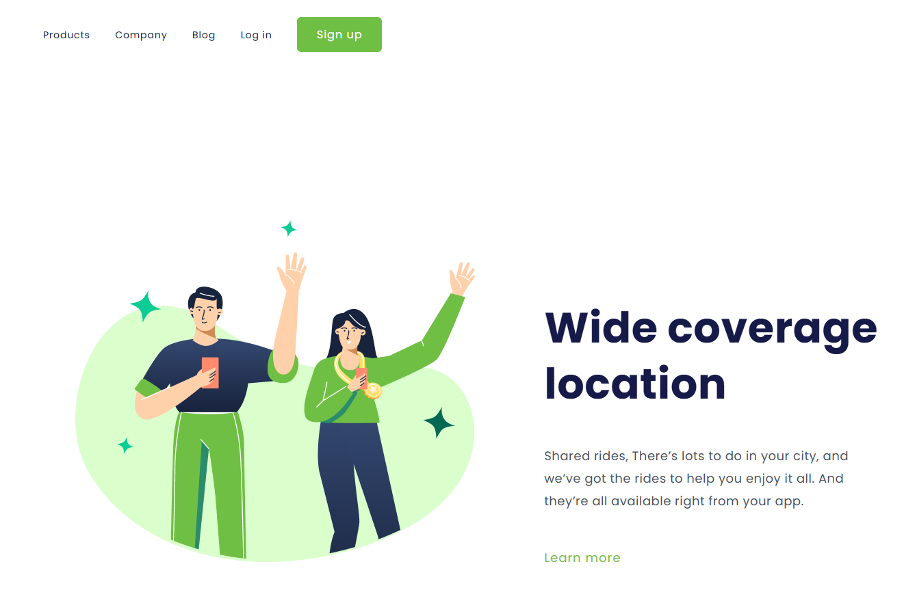

<h1>  🚗 Wide Coverage Location  </h1>

 

  Projeto de desenvolvimento de uma página web com foco em um serviço de transporte compartilhado (Shared Rides), desenvolvido para praticar e aprimorar meus conhecimentos em HTML5 e CSS3.

  A proposta é criar uma interface moderna, agradável e intuitiva, apresentando os benefícios de um aplicativo de mobilidade urbana.

  
 
<h2>  🎨 Prévia do projeto  </h2>

<!-- Adicione uma captura de tela do projeto aqui -->

 <a href="https://rogeriojr12.github.io/Wide-coverage-location/" target="_blank" rel="noopener noreferrer"> Preview Here </a>

 

<h3>  🛠️ Tecnologias utilizadas </h3>

- HTML5
   
- CSS3

 

<h4>  📚 O que estou aprendendo  </h4>

Durante o desenvolvimento deste projeto, estou colocando em prática conceitos como:

* Estruturação de páginas com HTML.
* Estilização de elementos com CSS.
* Organização de layouts.
* Posicionamento de elementos na página.
* Trabalhando com cores, fontes e espaçamentos.
* Construção de interfaces visuais.

 

<h5>  💻 Como executar o projeto  </h5>

1.  Clone este repositório:

git clone https://github.com/RogerioJR12/Wide-coverage-location/tree/main

2.  Entre na pasta do projeto:

cd nome-do-projeto

3.  Abra o arquivo index.html no navegador.

 
   
<h6>  🚀 Objetivo  </h5>

Este projeto faz parte da minha jornada de aprendizado em desenvolvimento web, com o objetivo de desenvolver minhas habilidades em HTML e CSS, explorar novas possibilidades de estilização e construir interfaces cada vez melhores.

 

<h7>  🔗 Acesse o projeto  </h7>

<a href="https://github.com/RogerioJR12/Wide-coverage-location/tree/main">  GitHub - 🚗 Wide Coverage Location    </a>

 

<h6>  👨‍💻 Autor  </h6>

Desenvolvido por RogerioJR12.

GitHub: @RogerioJR12

⭐ Se gostou do projeto, deixe uma estrela no repositório!
